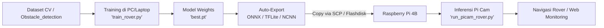

# Panduan Training Model YOLO & Deployment Pi Cam pada Raspberry Pi

Dokumen ini menjelaskan alur kerja (workflow) lengkap untuk melatih model AI deteksi rintangan (*Obstacle Detection*) rover dan menjalankannya secara real-time menggunakan Raspberry Pi Camera (Pi Cam) pada Raspberry Pi.

---

## 📌 Alur Kerja (Workflow)



> **Mengapa Training Dilakukan di PC/Laptop (Bukan di Raspi)?**  
> Melatih *Deep Learning* memerlukan daya komputasi tinggi (GPU). Raspberry Pi memiliki CPU hemat daya dan RAM terbatas; melatih model langsung di Raspberry Pi akan memakan waktu berhari-hari, memicu *overheating/throttling*, dan berisiko *Out-Of-Memory (OOM)*. Oleh karena itu, model dilatih di PC/Laptop, lalu diekspor ke format ringan untuk dideploy ke Raspberry Pi.

---

## 1. Persiapan & Training di Laptop/PC

### Langkah 1: Install Dependensi
Buka terminal/PowerShell di folder `Computer Vision`:
```bash
pip install -r requirements.txt
```
*(Pastikan PyTorch & Ultralytics terpasang)*.

### Langkah 2: Jalankan Training
Jalankan script [train_rover.py](train_rover.py):
```bash
python train_rover.py --epochs 50 --imgsz 416 --batch 16
```

**Penjelasan Parameter Utama:**
- `--model yolov8n.pt`: Menggunakan varian YOLOv8 **Nano** (bobot paling ringan & cepat, sangat ideal untuk CPU Raspberry Pi).
- `--imgsz 416`: Menggunakan resolusi 416x416 pixel (keseimbangan terbaik antara akurasi dan FPS di Raspberry Pi).
- `--epochs 50`: Jumlah iterasi pelatihan pada dataset `Obstacle_detection`.

Setelah training selesai:
- Model bobot terbaik otomatis tersimpan di: `runs/rover_train/rover_obstacle_model/weights/best.pt`.
- Script akan otomatis mengekspor model ke format **ONNX** (`best.onnx`) dan **TFLite/NCNN** untuk akselerasi Raspberry Pi.

---

## 2. Transfer Model ke Raspberry Pi

Salin file model hasil training ke Raspberry Pi menggunakan `scp` atau flashdisk:
```bash
scp runs/rover_train/rover_obstacle_model/weights/best.pt pi@<IP_RASPBERRY_PI>:~/rover_models/
```
*(Ganti `<IP_RASPBERRY_PI>` dengan alamat IP Raspberry Pi rover Anda)*.

---

## 3. Eksekusi Pi Cam pada Raspberry Pi

### Langkah 1: Persiapan di Raspberry Pi
Pastikan kamera Pi Cam sudah terpasang di port CSI dan diaktifkan:
```bash
# Cek deteksi kamera
rpicam-hello --list-cameras
# atau
vcgencmd get_camera
```

Install pustaka Ultralytics & OpenCV di Raspberry Pi:
```bash
pip install ultralytics opencv-python
```

### Langkah 2: Jalankan Inferensi Real-Time
Salin file [run_picam_rover.py](run_picam_rover.py) ke Raspberry Pi, lalu jalankan:

#### A. Mode dengan Monitor (GUI Preview):
```bash
python run_picam_rover.py --model ~/rover_models/best.pt --imgsz 416
```

#### B. Mode Headless (via SSH tanpa monitor):
```bash
python run_picam_rover.py --model ~/rover_models/best.pt --imgsz 416 --headless
```

#### C. Menggunakan Interface Libcamera/Picamera2:
```bash
python run_picam_rover.py --model ~/rover_models/best.pt --cam picamera2 --imgsz 416
```

---

## 4. Fitur Deteksi Rover
Script [run_picam_rover.py](run_picam_rover.py) dilengkapi dengan:
- **Sektor Navigasi (`KIRI`, `TENGAH`, `KANAN`)**: Menentukan di mana rintangan berada relatif terhadap kamera rover untuk mempermudah logika manuver/menghindar (*obstacle avoidance*).
- **Indikator Bahaya (Warna Merah)**: Menandai rintangan yang berada tepat di sektor tengah jalur rover.
- **FPS & Latency Monitor**: Menampilkan kecepatan proses frame per detik secara real-time.
