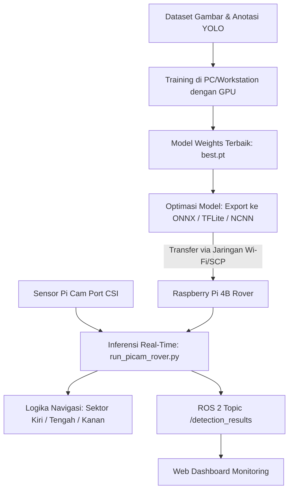

# Langkah-Langkah Pembuatan Model Computer Vision (CV) Rover untuk Pi Cam pada Raspberry Pi

Dokumen ini berisi panduan teknis komprehensif dari awal hingga akhir (*end-to-end*) mengenai proses pembuatan, pelatihan (*training*), optimasi (*export*), hingga penerapan (*deployment*) model AI Computer Vision berbasis **YOLOv8** untuk deteksi rintangan (*Obstacle Detection*) pada sistem rover menggunakan **Raspberry Pi Camera (Pi Cam)**.

---

## 📑 Daftar Isi
1. [Arsitektur Sistem & Alur Kerja](#1-arsitektur-sistem--alur-kerja)
2. [Tahap 1: Persiapan Dataset](#2-tahap-1-persiapan-dataset)
3. [Tahap 2: Setup Environment & Dependensi di PC](#3-tahap-2-setup-environment--dependensi-di-pc)
4. [Tahap 3: Pelatihan Model (Training Phase)](#4-tahap-3-pelatihan-model-training-phase)
5. [Tahap 4: Evaluasi & Ekspor Model ke Edge Device](#5-tahap-4-evaluasi--ekspor-model-ke-edge-device)
6. [Tahap 5: Pengiriman Model ke Raspberry Pi](#6-tahap-5-pengiriman-model-ke-raspberry-pi)
7. [Tahap 6: Pengujian & Inferensi Real-Time Pi Cam](#7-tahap-6-pengujian--inferensi-real-time-pi-cam)
8. [Tahap 7: Integrasi ke ROS 2 & Sistem Monitoring](#8-tahap-7-integrasi-ke-ros-2--sistem-monitoring)

---

## 1. Arsitektur Sistem & Alur Kerja



### Mengapa Pemisahan Komputasi Diperlukan?
- **Pelatihan (PC / Laptop / Cloud GPU):** Membutuhkan miliaran operasi komputasi matriks floating-point paralel. Pelatihan model pada board Raspberry Pi secara langsung tidak direkomendasikan karena memakan waktu berhari-hari, memicu *thermal throttling* (overheating), dan risiko kehabisan memori RAM (*Out-Of-Memory*).
- **Inferensi (Raspberry Pi 4B):** Model yang telah dilatih diekspor menjadi format teroptimasi (bobot terkuantisasi ringan) sehingga proses inferensi dapat berjalan efisien (10–25+ FPS) pada CPU ARM Raspberry Pi.

---

## 2. Tahap 1: Persiapan Dataset

### 2.1 Struktur Direktori Dataset
Dataset yang digunakan berada di folder `Dataset CV/Obstacle_detection` dengan format standar Ultralytics YOLO:

```text
Dataset CV/
└── Obstacle_detection/
    ├── data.yaml            <-- Konfigurasi kelas dan path
    ├── train/
    │   ├── images/          <-- Gambar untuk pelatihan
    │   └── labels/          <-- File .txt bounding box (format YOLO)
    ├── valid/
    │   ├── images/          <-- Gambar untuk validasi selama training
    │   └── labels/
    └── test/
        ├── images/          <-- Gambar evaluasi akhir
        └── labels/
```

### 2.2 Konfigurasi `data.yaml`
Pastikan file konfigurasi mendefinisikan path dan 7 kategori objek rintangan rover:
```yaml
path: .
train: train/images
val: valid/images
test: test/images

nc: 7
names: ['Animals-Level 1', 'Animals-Level 2', 'Natural disaster', 'bird', 'human', 'rock', 'vehicle']
```

> **Format Label TXT YOLO:**  
> Setiap file label berisi baris: `<class_id> <x_center> <y_center> <width> <height>` dengan nilai koordinat yang telah dinormalisasi antara 0.0 hingga 1.0.

---

## 3. Tahap 2: Setup Environment & Dependensi di PC

Buka terminal/PowerShell pada komputer workstation (PC/Laptop):

### 3.1 Buat Virtual Environment (Direkomendasikan)
```bash
python -m venv venv_cv
# Windows:
venv_cv\Scripts\activate
# Linux/Mac:
source venv_cv/bin/activate
```

### 3.2 Install PyTorch & Ultralytics
Untuk akselerasi GPU NVIDIA (CUDA):
```bash
pip install torch torchvision --index-url https://download.pytorch.org/whl/cu121
pip install ultralytics opencv-python onnx
```

Verifikasi ketersediaan GPU di terminal:
```bash
python -c "import torch; print('CUDA Tersedia:', torch.cuda.is_available())"
```

---

## 4. Tahap 3: Pelatihan Model (Training Phase)

### 4.1 Pemilihan Varian Model
Gunakan varian **YOLOv8 Nano (`yolov8n.pt`)**. Model ini memiliki parameter terkecil (~3,2 juta parameter) sehingga menghasilkan latensi paling rendah pada perangkat embedded Raspberry Pi.

### 4.2 Menjalankan Script Training
Gunakan script otomatis yang telah disediakan di `Computer Vision/train_rover.py`:

```bash
python "Computer Vision/train_rover.py" \
  --data "Dataset CV/Obstacle_detection/data.yaml" \
  --model yolov8n.pt \
  --epochs 50 \
  --imgsz 416 \
  --batch 16
```

### Penjelasan Parameter Kunci:
| Parameter | Nilai Rekomendasi | Alasan Teknis |
| :--- | :--- | :--- |
| `--model` | `yolov8n.pt` | Model paling ringan dengan kebutuhan RAM minimal pada edge device. |
| `--imgsz` | `416` | Resolusi 416x416 memberikan kompromi ideal antara kecepatan deteksi (FPS) dan akurasi objek pada Pi Cam dibandingkan resolusi standar 640x640. |
| `--epochs` | `50` - `100` | Cukup untuk konvergensi fitur rintangan tanpa menyebabkan overfitting. |
| `--batch` | `16` | Menyesuaikan kapasitas VRAM kartu grafis PC. |

Hasil pelatihan tersimpan di:  
`Computer Vision/runs/rover_train/rover_obstacle_model/weights/best.pt`

---

## 5. Tahap 4: Evaluasi & Ekspor Model ke Edge Device

### 5.1 Evaluasi Performa
Periksa metrik hasil training pada folder `runs/rover_train/rover_obstacle_model/`:
- **`confusion_matrix.png`**: Ketepatan klasifikasi antara kelas objek.
- **`results.png`**: Grafik penurunan loss (box, cls, dfl) dan peningkatan **mAP@50** (minimal diharapkan > 0.70 untuk keandalan navigasi).

### 5.2 Auto-Export ke Format Edge AI
Script `train_rover.py` secara otomatis melakukan konversi ke format berikut:
1. **ONNX (`best.onnx`)**: Format graf jaringan saraf standar yang dapat dieksekusi cepat menggunakan ONNX Runtime CPU.
2. **TFLite (`best.tflite` / `best_saved_model`)**: Format TensorFlow Lite yang mendukung inferensi hemat daya.
3. **NCNN (`best_ncnn_model`)**: Format akselerasi tinggi khusus untuk prosesor arsitektur ARM pada SBC.

---

## 6. Tahap 5: Pengiriman Model ke Raspberry Pi

Salin file bobot model terbaik dari PC ke Raspberry Pi menggunakan protokol Secure Copy (`scp`) melalui jaringan Wi-Fi lokal:

```bash
# Contoh pengiriman file best.pt:
scp "Computer Vision/runs/rover_train/rover_obstacle_model/weights/best.pt" pi@<IP_RASPBERRY_PI>:~/rover_models/

# Atau pengiriman file format ONNX:
scp "Computer Vision/runs/rover_train/rover_obstacle_model/weights/best.onnx" pi@<IP_RASPBERRY_PI>:~/rover_models/
```
*(Ganti `<IP_RASPBERRY_PI>` dengan alamat IP Raspberry Pi rover).*

---

## 7. Tahap 6: Pengujian & Inferensi Real-Time Pi Cam

### 7.1 Persiapan Hardware Pi Cam pada Raspberry Pi
1. Hubungkan kabel pita (*ribbon cable*) Pi Cam ke port CSI Raspberry Pi (pastikan pin kontak menghadap ke arah port HDMI).
2. Verifikasi deteksi kamera melalui terminal Raspberry Pi OS:
   ```bash
   rpicam-hello --list-cameras
   # atau pada OS versi legacy:
   vcgencmd get_camera
   ```
3. Install dependensi di Raspberry Pi:
   ```bash
   pip install ultralytics opencv-python
   ```

### 7.2 Menjalankan Script Deteksi Real-Time
Salin file [run_picam_rover.py](file:///c:/Users/asus/Documents/Despro/Computer%20Vision/run_picam_rover.py) ke Raspberry Pi, lalu eksekusi:

#### Mode 1: Headless (Melalui SSH tanpa monitor)
```bash
python run_picam_rover.py \
  --model ~/rover_models/best.pt \
  --imgsz 416 \
  --headless
```

#### Mode 2: Tampilan GUI Video Preview (HDMI / VNC)
```bash
python run_picam_rover.py \
  --model ~/rover_models/best.pt \
  --imgsz 416
```

#### Mode 3: Menggunakan Driver Resmi Picamera2
```bash
python run_picam_rover.py \
  --model ~/rover_models/best.pt \
  --cam picamera2 \
  --imgsz 416
```

### 7.3 Logika Pemetaan Sektor Rintangan (Obstacle Avoidance)
Script membagi bidang pandang horizontal kamera menjadi 3 sektor navigasi:
- **Sektor KIRI**: Objek berada di sisi kiri rover -> Rover dapat menghindar ke arah kanan.
- **Sektor TENGAH (Peringatan Bahaya / Bounding Box Merah)**: Objek berada tepat di jalur depan rover -> Pemicu rem darurat (*emergency brake*) atau manuver rotasi.
- **Sektor KANAN**: Objek berada di sisi kanan rover -> Rover dapat menghindar ke arah kiri.

Terminal akan menampilkan log telemetri:
```text
[DETEKSI] FPS: 18.4 | Latensi: 54.3ms | Objek: human(TENGAH, 0.88), rock(KANAN, 0.76)
```

---

## 8. Tahap 7: Integrasi ke ROS 2 & Sistem Monitoring

Untuk mengintegrasikan deteksi objek ke dalam ekosistem robotika ROS 2 Humble pada rover:

1. Letakkan model `best.pt` pada package ROS 2 di:  
   `Computer Vision/cv_ws/src/rover_cv/rover_cv/`
2. Buka berkas [object_detection_node.py](file:///c:/Users/asus/Documents/Despro/Computer%20Vision/cv_ws/src/rover_cv/rover_cv/object_detection_node.py) dan arahkan pemanggilan model ke bobot hasil training:
   ```python
   self.model = YOLO('best.pt')
   ```
3. Node akan berlangganan (*subscribe*) ke topik gambar mentah `/image_raw` dari driver Pi Cam, memproses bounding box, dan memublikasikan hasil deteksi ke topik `/detection_results` dalam format JSON.
4. Topik `/detection_results` dibaca oleh `rosbridge_server` (port 9090) untuk divisualisasikan secara langsung pada antarmuka web monitoring dashboard.

---

## 💡 Tips & Trik Optimasi Performa
1. **Pencahayaan Kamera**: Pi Cam sangat sensitif terhadap intensitas cahaya. Tambahkan lampu LED pada chassis rover jika beroperasi di area minim cahaya atau simulasi bencana.
2. **Thermal Throttling**: Pasang kipas pendingin (*active cooling fan*) pada Raspberry Pi 4B agar frekuensi CPU tidak turun saat melakukan inferensi kontinu.
3. **Penyelarasan Sumbu (Coordinate Alignment)**: Letakkan dudukan Pi Cam sejajar lurus dengan sensor LiDAR rover agar data fusi antara kamera (klasifikasi objek) dan LiDAR (jarak presisi) selaras.
